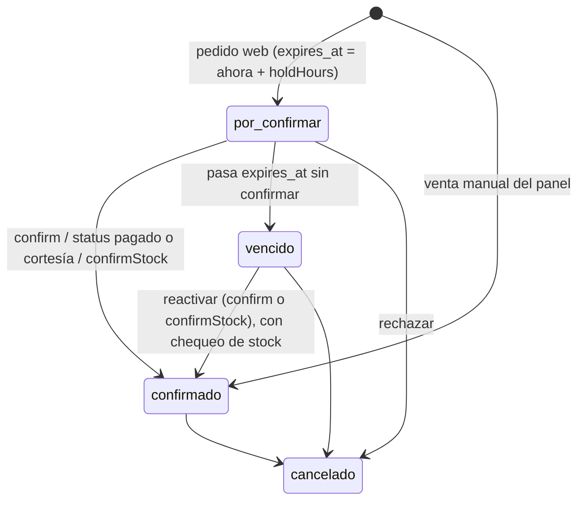

# ADR-4 — Pedidos por confirmar, límite por teléfono, encargos y avisos por Telegram

- **Estado:** aceptado
- **Fecha:** 2026-11-06
- **Plan:** PLAN-11
- **Supersede parcialmente:** ADR-3 (definición de «venta viva» en la fórmula del stock)

---

## 1. Contexto

ADR-3 fijó el stock como dato propio:

`stock = Σ stock_movements.delta − Σ orders.quantity_hallacas` (pedidos con `status != 'cancelado'` y `stock_exempt = 0`).

La auditoría del 5 nov 2026 encontró tres problemas sobre esa fórmula:

- **C1 (crítico):** todo pedido web reserva stock para siempre, aunque el dueño nunca lo valide. Un pedido falso o abandonado bloquea hallacas reales.
- **A1:** reactivar un pedido cancelado o subirle la cantidad desde el panel no revisa el stock, así que permite sobreventa.
- **M5:** las transacciones de `createOrder` y del panel son diferidas (`BEGIN DEFERRED`). La lectura del stock y la escritura del pedido no quedan protegidas contra otra escritura concurrente.

El dueño pide además un tope de hallacas por cliente en la web, un registro de encargos grandes para la próxima tanda y un aviso cuando entra un pedido, porque hoy se entera solo si el cliente le escribe por WhatsApp.

## 2. Decisiones

- **D1.** No se cambia el `CHECK` de `orders.status`. Las columnas nuevas se añaden con `ALTER TABLE ... ADD COLUMN`, sin swap de tabla.
- **D2. Estado de revisión derivado, no guardado:**
  - `confirmado` si `confirmed_at IS NOT NULL`;
  - `por_confirmar` si `confirmed_at IS NULL AND expires_at > datetime('now')`;
  - `vencido` si `confirmed_at IS NULL AND expires_at <= datetime('now')`.

  El vencimiento no depende de un cron: se evalúa en cada consulta.
- **D3. Pedido vivo** = `status != 'cancelado' AND (confirmed_at IS NOT NULL OR expires_at > datetime('now'))`. El fragmento vive en un único lugar: `backend/utils/orderState.js` (`LIVE_ORDER_SQL`).
- **D4.** Las fechas nuevas se guardan en UTC con `datetime('now')`, igual que `created_at`. La UI convierte a hora local.
- **D5.** Duración de la reserva: `ORDER_HOLD_HOURS` (por defecto 24, rango 1..168). Aviso previo: `ORDER_REMINDER_HOURS_BEFORE` (por defecto 4, rango 0..`holdHours − 1`). Si el valor por defecto no cabe en el rango (por ejemplo, con `ORDER_HOLD_HOURS=1`), se usa `min(4, holdHours − 1)`.
- **D6. Límite por teléfono:** `MAX_HALLACAS_POR_TELEFONO` (por defecto 20).
  - Suma las hallacas de pedidos web (`source = 'web'`) del mismo teléfono normalizado y, si hay sesión, también las del mismo `user_id`.
  - Solo cuentan pedidos vivos (D3) y no entregados (`delivered_at IS NULL`).
  - Incluye encargos web (`stock_exempt = 1`, pack `pXL`).
  - Se valida `suma_actual + hallacas_del_pedido_nuevo`.
- **D7.** Las ventas manuales (`source = 'admin'`) nacen confirmadas (`confirmed_at = datetime('now')`), sin `expires_at` y sin el límite de D6.
- **D8. Encargo para próxima tanda** = venta manual con `encargo: true`, guardada con `stock_exempt = 1`. Se concreta con el flujo `confirmStock` existente. Concretar un encargo también lo **confirma** (fija `confirmed_at`), porque implica que el dueño lo validó. Sin eso, un encargo web vencido quedaría «concretado» sin reservar stock, y uno por confirmar dejaría de reservar al pasar `expires_at`.
- **D9.** El rechazo web por límite o falta de stock responde 409 `{ error, code }`:
  - `code`: `LIMITE_TELEFONO` o `SIN_STOCK`;
  - `error`: `Para un pedido así, ponte en contacto directo con el vendedor.`
- **D10.** En el panel, toda operación que aumente la reserva sin stock suficiente responde 409 `{ code: 'STOCK_INSUFICIENTE', error, stock, requerido }`, donde `requerido` es el **incremento** de reserva que pide la operación. El admin puede reenviar con `force: true`.
- **D11.** Sin `TELEGRAM_BOT_TOKEN` o `TELEGRAM_CHAT_ID`, el notificador no envía nada (solo `console.info`). Un fallo de Telegram nunca hace fallar un pedido. Los mensajes van en texto plano, sin `parse_mode`.
- **D12.** Se quita `.escape()` de `address` y `notes` en `orders.routes.js`. React escapa al mostrar y Telegram recibe texto plano. Los datos antiguos ya escapados no se migran.
- **D13. Canal de avisos: bot de Telegram**, elegido por el dueño. `backend/services/notify.js` habla solo con la Bot API de Telegram. Alternativas descartadas:
  - **ntfy:** exige instalar y suscribirse a otra app, y los temas públicos son legibles por cualquiera que adivine el nombre.
  - **Correo:** el dueño no lo revisa en el momento y requiere un proveedor SMTP con credenciales y reputación de envío.
  - **WhatsApp Cloud API:** exige cuenta Business verificada y plantillas de mensaje pagadas y aprobadas por Meta.

## 3. Diagrama de estados de revisión



`cancelado` es el `status` de pago, ortogonal al estado de revisión: un pedido cancelado no está vivo, sea cual sea su revisión. Volver de `cancelado` a otro `status` pasa por el chequeo de stock de D10.

## 4. Cambio en la fórmula del stock

Antes (ADR-3):

```sql
status != 'cancelado' AND stock_exempt = 0
```

Ahora:

```sql
status != 'cancelado'
AND (confirmed_at IS NOT NULL OR expires_at > datetime('now'))
AND stock_exempt = 0
```

Un pedido vencido deja de restar en el mismo instante en que pasa `expires_at`, sin que corra ningún proceso. Si el dueño lo reactiva, vuelve a restar y la reactivación revisa el stock dentro de una transacción `.immediate()`.

## 5. Lugares donde se filtraba `status != 'cancelado'`

Resultado de `grep -rn "cancelado" backend` antes del cambio. Las consultas de stock, kardex y reportes que pasan a usar `LIVE_ORDER_SQL`:

- `controllers/packs.controller.js:29` — `getStock`, comprometidas.
- `controllers/packs.controller.js:52` — `getStockBreakdown`, comprometidas.
- `controllers/packs.controller.js:56` — `getStockBreakdown`, entregadas.
- `controllers/stock.controller.js:55` — kardex, ventas vivas.
- `controllers/stock.controller.js:92` — kardex, encargos por coordinar.
- `controllers/admin.controller.js:460` — reportes, ventas.
- `controllers/admin.controller.js:465` — reportes, por método.
- `controllers/admin.controller.js:479` — reportes, montos.
- `controllers/admin.controller.js:486` — reportes, ventas de hoy.
- `controllers/admin.controller.js:506` — reportes, encargos.

No hay más consultas con ese filtro. El resto de las coincidencias son:

- comentarios (`packs.controller.js:11`, `admin.controller.js:6, 304, 428`, `admin.routes.js:27`);
- el vocabulario del enum (`admin.controller.js:13`, `migrate.js:18-33`);
- la validación de `confirmStock` sobre un cancelado (`admin.controller.js:172`).

`porEstado` (`admin.controller.js:471`) no filtra por vivo a propósito: cuenta todos los `status`. Ahora se complementa con los contadores `por_confirmar` y `vencidos`.

## 6. Migración

Orden de `runMigrations()` comprobado en `migrate.js`:

1. `migrateOrdersLegacy`
2. `addOrdersAddressColumn`
3. `migrateOrdersStatusEnum`
4. `migrateUsersTable`
5. `createProductionBatchesTable`
6. `createStockMovementsTable`
7. `addOrdersDeliveredAtColumn`
8. `addOrdersBatchIdColumn`
9. `migrateOrdersFinalStatusEnum`
10. `addOrdersStockExemptColumn`
11. **`addOrdersReviewColumns` (nueva)**
12. `seedSettings`
13. `seedPacks`

`migrateOrdersFinalStatusEnum` (9) corre antes que `addOrdersStockExemptColumn` (10) y que la migración nueva (11). Los swaps de tabla terminan antes de que existan las columnas nuevas, así que no se pierden datos y `ORDERS_FINAL_SQL` no se toca. Solo se le añade un comentario: toda recreación futura de `orders` debe incluir y copiar `stock_exempt`, `confirmed_at`, `expires_at`, `reminder_sent_at` y `expired_notified_at`.

La migración nueva corresponde al paso 11 porque los seeds no tocan `orders`.

**Backfill.** Se ejecuta en cada arranque, dentro de una transacción:

```sql
UPDATE orders SET confirmed_at = created_at
WHERE confirmed_at IS NULL AND expires_at IS NULL;
```

**Invariante.** Ningún INSERT de `orders` deja `confirmed_at` y `expires_at` ambos en NULL. `grep -rn "INSERT INTO orders" backend` devuelve:

- `orders.controller.js` (`createOrder`): fija `expires_at`;
- `admin.controller.js` (`createManualSale`): fija `confirmed_at`;
- `migrate.js`: tres `INSERT INTO orders_new`, dentro de swaps que corren antes de la migración nueva.

Por eso solo las filas anteriores al cambio quedan con ambas columnas en NULL. Esas filas ya reservaban stock, así que confirmarlas conserva el stock exacto.

**Índices.** `idx_orders_phone`, `idx_orders_review` e `idx_order_items_order` se crean dentro de `addOrdersReviewColumns`, no en `schema.sql`. `db.js` ejecuta `schema.sql` antes de las migraciones: en una BD existente, `CREATE TABLE IF NOT EXISTS orders` no hace nada y un `CREATE INDEX` sobre `confirmed_at` fallaría porque la columna aún no existe. En la BD más antigua, ni siquiera existe `customer_phone`.

`withTableSwap` se envuelve en `try/finally` para que `foreign_keys` vuelva a `ON` aunque el swap falle.

## 7. Concurrencia

- `createOrder`, `updateOrder` y `createManualSale` corren en `db.transaction(...).immediate()`. El lock de escritura se toma al empezar, así que el stock leído es el que queda reservado.
- `updateOrder` relee el pedido dentro de la transacción antes de calcular la reserva previa.
- Un `SQLITE_BUSY*` se traduce en 503 `{ error: 'Servidor ocupado, intenta de nuevo.' }`.

## 8. Avisos

- `notify.newOrder` se llama después del commit, sin bloquear la respuesta.
- Un barrido cada 10 minutos (y uno al arrancar) envía «por vencer» y «vencido» una sola vez por pedido. Las columnas `reminder_sent_at` y `expired_notified_at` lo hacen idempotente.
- Una marca solo se escribe si el envío fue OK. Sin token configurado se marca igual, para evitar una avalancha de avisos viejos cuando se configure.
- El barrido no participa en ninguna regla de negocio: el vencimiento ya se evalúa en cada consulta.

## 9. Riesgos

- **Render con instancia que se duerme:** los avisos llegan con retraso, pero el stock vence a tiempo porque no depende del barrido.
- **Reloj:** `datetime('now')` usa el reloj del servidor en UTC. Un salto del reloj adelanta o atrasa vencimientos.
- **Datos escapados antiguos:** las notas y direcciones guardadas antes del cambio pueden mostrar entidades HTML (`&amp;`). No se migran.
- **Límite por teléfono:** un cliente puede evadirlo con otro número. Es una barrera contra errores y abusos casuales, no contra fraude.
- **Rate limit por IP detrás del proxy de Render:** sin `TRUST_PROXY=1`, todas las peticiones comparten la IP del proxy y `orderLimiter` bloquearía a todos los clientes a la vez.
- **Recreaciones futuras de `orders`:** un swap que olvide copiar las columnas nuevas confirmaría por backfill todos los pedidos web pendientes.
